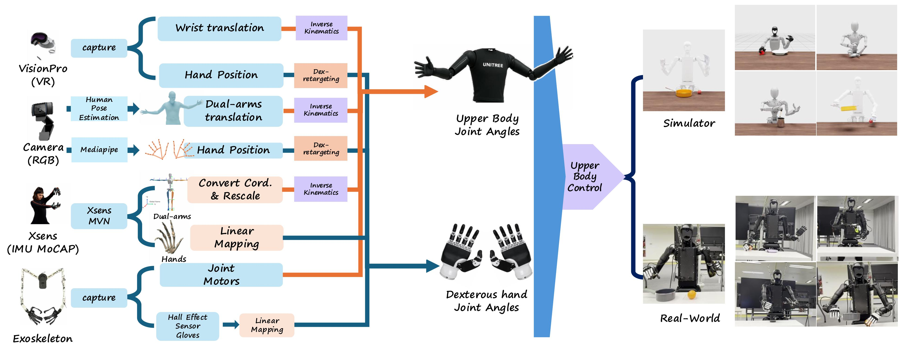

# TeleOpBench: A Simulator-Centric Benchmark for Dual-Arm Dexterous Teleoperation

Hangyu Li $^{\color{red}{\*}}$, Qin Zhao $^{\color{red}{\*}}$, Haoran Xu, Xinyu Jiang, Qingwei Ben, Feiyu Jia, Haoyu Zhao, Liang Xu, Jia Zeng, Hanqing Wang, Bo Dai, Junting Dong $^{\**}$, Jiangmiao Pang

$\color{red}{\*}$: Equal contribution.
\**: Corresponding author.

### [Project Page](https://gorgeous2002.github.io/TeleOpBench/) | [Arxiv Paper](https://arxiv.org/abs/2505.12748) | [Video](https://youtu.be/PbimvvNCIdc)

 
---

# 📷 Camera-Based Human Motion Capture Pipeline

This document explains how to use our camera-based method to capture human motion and drive the TeleOpBench system. The pipeline consists of two components:

1. **Human motion capture via webcam using SMPLerX + MediaPipe**
2. **Motion control in TeleOpBench with real-time visualization**

---

## 🧍 Step 1: Human Motion Capture

We use a webcam to capture human motion, then process it using [SMPLerX](https://github.com/vchoutas/smplx) and [MediaPipe](https://github.com/google/mediapipe).

### 📦 Setup

Clone the repository:

```bash
git clone https://github.com/cyjdlhy/smpler_media.git
cd smpler_media
```

Install the required environment and download models by following instructions from the official SMPL-X repository:
👉 [https://github.com/vchoutas/smplx](https://github.com/vchoutas/smplx)

Then activate the environment:

```bash
conda activate smplerx
```

Install MediaPipe:

```bash
pip install mediapipe
```

### 🎥 Run Motion Capture

To start capturing motion via webcam:

```bash
cd main
bash run.sh
```

This will capture motion data (body pose + hand position) and send it for downstream processing.

---

## 🤖 Step 2: Motion Control in TeleOpBench

The motion data is received by TeleOpBench, which performs inverse kinematics (IK) and controls a robot accordingly, with real-time visualization.

### ⚙️ Setup

Activate the TeleOpBench environment:

```bash
conda activate teleop
```

Navigate to the teleop directory and run:

```bash
cd teleop
./run.sh
```

### 🕸️ Visualization

Once started, MeshCat will launch automatically, displaying real-time 3D visualization of the robot executing the motion.

---


# 🥽 VisionPro-Based Teleoperation Pipeline

This document explains how to use our VR-based method to capture human motion and drive the TeleOpBench system. The pipeline consists of two components:

1. **Hand motion capture via VR**
2. **Motion control in TeleOpBench with real-time visualization**

## 🧍 Step 1: Hand motion capture via VR

⚠️ **Make sure the Vision Pro and the computer are connected to the same local network (LAN)!**

1. check **Host machine** local ip address:

```bash
ifconfig | grep inet # Check the local IP address
```

2. install mkcert

   please refer to [https://github.com/FiloSottile/mkcert]
3. create certificate:

```bash
cd teleop
mkcert -install && mkcert -cert-file cert.pem -key-file key.pem 192.168.123.1 localhost 127.0.0.1
```

4. open firewall on server:

```bash
sudo ufw allow 8012
```

5. install ca-certificates on Apple Vision Pro:

```bash
mkcert -CAROOT
```

Copy the `rootCA.pem` via AirDrop to Apple Vision Pro and install it.

Settings > General > About > Certificate Trust Settings. Under "Enable full trust for root certificates", turn on trust for the certificate.

> In the new version of Vision OS 2, this step is different: After copying the certificate to the Apple Vision Pro device via AirDrop, a certificate-related information section will appear below the account bar in the top left corner of the Settings app. Tap it to enable trust for the certificate.

Settings > Apps > Safari > Advanced > Feature Flags > Enable WebXR Related Features.


6. Open Safari on Apple Vision Pro and visit:

https://192.168.123.1:8012?ws=wss://192.168.123.1:8012

Make sure `192.168.123.1` is the IP address of your **Host machine**.

Click **Enter VR** and select **Allow** to start the VR session.


# 🤖 Step 2: Motion Control in TeleOpBench

### ⚙️ Setup

Activate the TeleOpBench environment:

```bash
conda activate teleop
```

Navigate to the teleop directory and run:

./run.sh

### 🕸️ Visualization

Once started, MeshCat will launch automatically, displaying real-time 3D visualization of the robot executing the motion.


---

### Acknowledgements

This project is built upon the work of several excellent research projects and open-source contributions. A big thank you to all the authors for sharing their work!

- [avp_teleoperate](https://github.com/unitreerobotics/avp_teleoperate) 
- [pink](https://github.com/stephane-caron/pink.git) 
- [TeleVision](https://github.com/OpenTeleVision/TeleVision) 
- [GRUtopia](https://github.com/OpenRobotLab/GRUtopia) 

---

### Citation

If you find this project useful in your research, please consider citing our paper:

```bibtex
@article{li2025teleopbench,
  title={TeleOpBench: A Simulator-Centric Benchmark for Dual-Arm Dexterous Teleoperation},
  author={Li, Hangyu and Zhao, Qin and Xu, Haoran and Jiang, Xinyu and Ben, Qingwei and Jia, Feiyu and Zhao, Haoyu and Xu, Liang and Zeng, Jia and Wang, Hanqing and others},
  journal={arXiv preprint arXiv:2505.12748},
  year={2025}
}